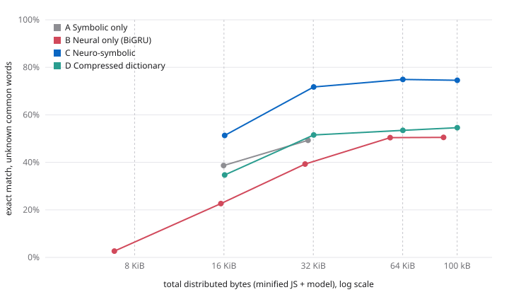

# tiny-furigana-food

**English** | [日本語版 README はこちら](README.ja.md)

> Architecture diagrams, build pipeline and configuration: **[docs/ARCHITECTURE.md](docs/ARCHITECTURE.md)** (mermaid) · Research report (Japanese): **[docs/REPORT.md](docs/REPORT.md)**

**A neuro-symbolic Japanese furigana (grapheme-to-phoneme) engine specialised for food product names, in ~140 KB (or under 100 KB with the smaller model).** Pure TypeScript, zero runtime dependencies, no WASM, fully offline.

> **Research stage.** Accuracy is focused on food names and place names; it is not meant for reading general Japanese text. It does not claim to be a general-purpose reading engine, hence the `-food` suffix.

The case study is automatic furigana input for a food product registration form. The ideas themselves do not depend on that domain:

- combine symbolic candidate generation, a tiny learned scorer, and an exception lexicon chosen within a size budget
- allocate the byte budget explicitly between them

We expect the same approach to carry over to other input helpers with domain vocabulary (product names, place names, company names, and so on).

```bash
npm install @mrksye/tiny-furigana-food
```

```ts
import { createReader } from "@mrksye/tiny-furigana-food";

const read = await createReader();   // loads model.bin next to the module once
read("大根");          // "だいこん"
read("八街落花生");    // "やちまたらっかせい"
read("牛乳500ml");     // "ぎゅうにゅう500ml"
```

After initialisation, `read` is synchronous and deterministic. Characters it cannot read are returned as they are, never dropped or replaced. **The design assumes the user corrects the result by hand.**

## Size and accuracy

| Artifact | Default (balanced, `R-135k-ct`) | Strict 100 KB (`R-100k-mf`) |
|---|---|---|
| `dist/tiny-g2p.min.js` | 8,589 B | 8,589 B |
| Model | `dist/model.bin` 130,656 B | `dist/model-100k.bin` 91,396 B |
| **Total (uncompressed)** | **139,245 B** | **99,985 B** |
| gzip / brotli | 131,065 / 128,493 B | 93,645 / 91,940 B |

To use the 100 KB variant, pass the URL of `model-100k.bin` to `createReader({ url })` (see [Loading the model](#loading-the-model)).

| Evaluation | Balanced | 100 KB |
|---|---|---|
| 64 real food-truck menu items (private data, not used for training) | **96.9%** | 89.1% |
| 18 input/output examples from the specification | 15/18 | 10/18 |
| Well-known place names (seen in training) | 88.4% | 55.7% |
| Known words | 98.5% | 94.7% |
| **Unknown words** (held out of training; measured with the same configuration trained without the evaluation data) | 74.9% | 75.4% |
| Unknown compounds (same as above) | 80.3% | 80.6% |

Long-vowel spelling variants (じゅーす / じゅうす) are not counted as errors.
The released models are trained on all data, so unknown-word accuracy is measured on held-out builds. See REPORT §6.11 for the method.
Every change is checked not only for accuracy but also for inputs that were correct before and became wrong, across all evaluation sets (`research/tools/regress.ts`, REPORT §6.12).
Inference takes about 13 µs per input and initialisation about 9–17 ms (Bun 1.4.5, Linux). Not measured in browsers.

### Size compared with existing libraries

Measured from the published packages (2026-11-25, latest versions on npm / PyPI). "Needed for readings" is the analyser plus the dictionary required to produce kanji readings.

| Library | Method | Needed for readings | Compressed |
|---|---|---|---|
| **tiny-furigana-food** (default / 100 KB) | rules + linear CRF + exception lexicon | **139,245 B / 99,985 B** | gzip 131 KB / 94 KB |
| kuromoji.js 0.1.2 (the analyser used by kuroshiro) | morphological analysis + IPADIC | `dict/` 100.3 MB (unpacked) + `kuromoji.js` 308 KB | gzip 17.8 MB + 67 KB as shipped |
| pykakasi 2.3.0 | dictionary lookup | 9.9 MB (`kanwadict4.db` 9.75 MB) | wheel 2.4 MB |
| ipadic 1.0.0 (MeCab dictionary) | morphological analysis | 52.9 MB | sdist 13.4 MB |
| SudachiDict-small 20261015 | morphological analysis | 115.3 MB | wheel 42.5 MB |
| SudachiDict-core 20261015 | morphological analysis | 202.3 MB | wheel 76.9 MB |
| unidic-lite 1.0.8 (MeCab dictionary) | morphological analysis | 260.5 MB | sdist 47.4 MB |
| wanakana 5.3.1 (reference) | kana ⇔ romaji only; cannot read kanji | 20,733 B | gzip 7.0 KB |

Even against kuromoji.js, the smallest of these that reads kanji in the browser, the transfer size is about 1/140.
On the other hand, those morphological analysers read general vocabulary almost perfectly thanks to their large dictionaries, and tiny-furigana-food's unknown-word accuracy (about 75%) falls short of that.
In exchange for its size, it keeps its accuracy by focusing on food names and place names.
Accuracy has not been compared on the same data.

## How it works

```
NFKC normalisation → character classes → candidate lattice (per-kanji reading candidates,
                     optional rendaku / gemination / handakuten, exception lexicon)
                   → scoring with hashed linear features (CRF-trained, int4) → Viterbi → hiragana
```

Four approaches — symbolic layer, tiny neural (linear) layer, lexicon only, and neural only — were compared under the same size budget and the same evaluation data. The results and the reasoning behind the design are in **[docs/REPORT.md](docs/REPORT.md)** (Japanese). Main findings:

- The correct reading is among the lattice candidates 95% of the time. The problem is choosing among them, and what worked was **a linear CRF over hashed candidate × context conjunction features**. At the same parameter count, an MLP did not beat the linear model.
- The exception lexicon helps known words; the weights help unknown words. Growing the budget to 200 KB leaves unknown-word accuracy flat at 75–76%; extra capacity only buys memorisation of food words and place names, and that saturates at 135 KB.
- In real use, filling data gaps mattered most: recovering words whose readings are written in katakana (餃子, 烏龍茶), detecting food words from their glosses, and adding municipality names and their stems from postal code data (宇治, 十勝).
- Canonical Huffman coding, MSE-optimal quantisation scales, and dropping prior scores (using candidate order instead) shrank the model by about 30% at the same accuracy.



## Directory layout

If you only use the library, `src/` and `dist/` are all you need. Dependencies go one way, `src` ← `train` ← `research`, and `src/` reads no other directory.

```
src/         the library (runs in the browser); public API in reader.ts
dist/        distributed files (tiny-g2p.min.js, node.js, tiny-g2p.d.ts, model.bin, model-100k.bin, SIZES.json)
demo/        browser demo
tests/       bun test
train/       tools that build the released model (Bun: training, exception lexicon, encoding, bundling; prep/: Python preprocessing)
research/    research and comparisons
  runtime/   experimental decoders (two-pass loop, neural-only system B)
  tools/     evaluation, regression checks, experiment runner, summaries, plots, benchmarks
  neural/    training for system B (PyTorch)
  models/    models for comparison and release candidates
  data/eval/ evaluation sets
  results/   results of every experiment (results.jsonl, experiments.md), logs, Pareto plot
docs/        research report, architecture, data sources
```

## Usage

```bash
bun install
bun test                          # unit + release-model regression tests
bun run research/tools/serve.ts   # demo at http://localhost:8787/demo/
bun run research/tools/bench.ts   # init / latency / heap
```

### Loading the model

`createReader()` loads `model.bin` from next to the module, once.

- **Browser**: fetched with `fetch`. With a bundler, either make sure `model.bin` is served next to the module, or point to it with `url` / `data` below.
- **Node / Bun / Deno**: the `node` condition in `package.json` selects `dist/node.js`, which reads the file from disk (Node's `fetch` cannot read `file:` URLs). This code is not included in the browser bundle.

Pass a location with `url`, or the model bytes (`ArrayBuffer` or `Uint8Array`) with `data`.

```ts
// 100 KB variant (Node)
const read = await createReader({ url: new URL("./model-100k.bin", import.meta.resolve("@mrksye/tiny-furigana-food")) });

// From a URL you serve yourself (browser)
const read2 = await createReader({ url: "/assets/model-100k.bin" });

// Pass the bytes
const read3 = await createReader({ data: await (await fetch("/assets/model.bin")).arrayBuffer() });
```

Steps to reproduce from training are in [docs/REPORT.md §10](docs/REPORT.md#10-再現手順) (Japanese). Raw data is not included in the repository.

## License

- **Data-derived files** (`dist/*.bin`, `research/models/*.bin`, `research/data/eval/*.tsv`) are derived from JMdict, KANJIDIC2 and JMnedict (© Electronic Dictionary Research and Development Group) and are therefore distributed under [CC BY-SA 4.0](https://creativecommons.org/licenses/by-sa/4.0/). Apps that embed them must show attribution and a link to the licence. See **[docs/DATA_SOURCES.md](docs/DATA_SOURCES.md)**.
- **Source code** (`src/`, `train/`, code under `research/`, `tests/`, `demo/`) is [MIT](LICENSE).

This package uses the [JMdict](https://www.edrdg.org/wiki/index.php/JMdict-EDICT_Dictionary_Project), [KANJIDIC2](https://www.edrdg.org/wiki/index.php/KANJIDIC_Project) and JMnedict dictionary files. These files are the property of the [Electronic Dictionary Research and Development Group](https://www.edrdg.org/), and are used in conformance with the Group's [licence](https://www.edrdg.org/edrdg/licence.html). Per-character reading alignments come from [JmdictFurigana](https://github.com/Doublevil/JmdictFurigana).
