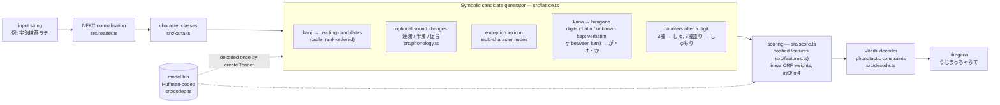
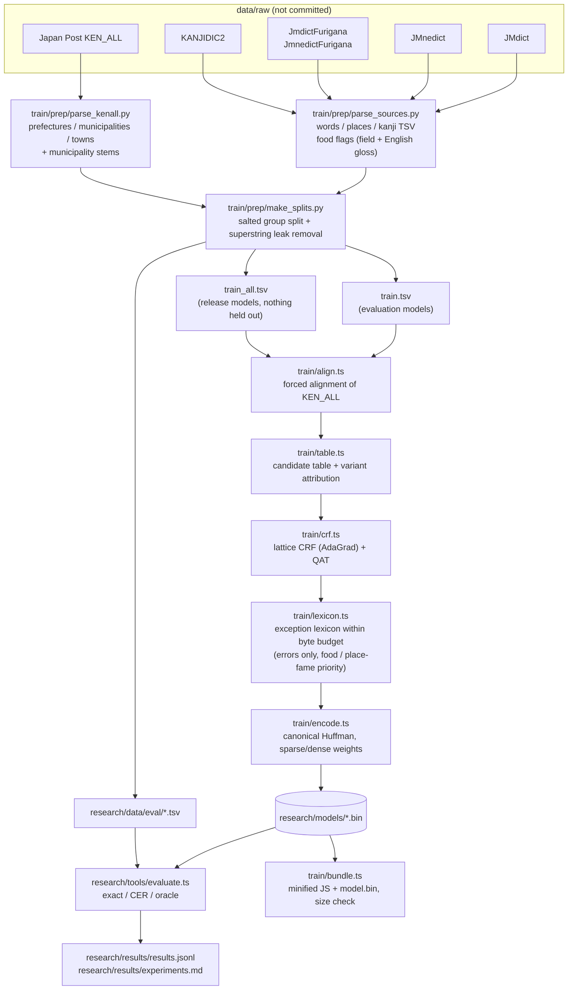
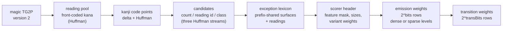

# Architecture

This page describes how the library is put together, how the model is built, and which settings control it.
The design rationale and measurements are in [REPORT.md](REPORT.md).

## 1. Runtime (browser / Bun / any ES2022 runtime)

- `createReader()` fetches `model.bin` once (or takes the bytes as `data`) and decodes it into typed arrays.
  After that, `read()` is synchronous and deterministic.
- Every input position always has at least one lattice node, so decoding never fails.
  Characters without candidates are copied unchanged.

## 2. Model build pipeline (training time only)

The training code imports the **same** `src/lattice.ts` and `src/features.ts` that the browser uses, so training and inference cannot drift apart.
System B (neural only, for comparison) is trained by `research/neural/neural_only.py` (PyTorch) and encoded by `research/tools/neural-export.ts`.

## 3. Binary model layout (`src/codec.ts`, format v2)

## 4. Configuration

All experiment and release configurations live in `train/configs.ts`. One entry is a `BuildConfig` (`train/pipeline.ts`):

| Field | Meaning | Release (`R-135k-ct`) |
|---|---|---|
| `table.maxKanji` / `maxCands` / `minShare` | size of the single-kanji candidate table | 3000 / 8 / 0.005 |
| `table.placeWeight` | weight of place names when counting readings | 3 |
| `priorBits` | per-candidate prior bits (0 = rank order only) | 0 |
| `crf.bits` / `transBits` | log2 rows of the hashed emission / transition tables | 17 / 14 |
| `crf.feats` | feature-group mask (`F_CTX`, `F_CAND_CHAR`, `F_OKURI`, `F_TRANS_CLS`, `F_TRANS_LEX`) | all |
| `crf.epochs` / `lr` / `seed` | training schedule (best dev epoch is kept) | 3 / 0.1 / 1 |
| `crf.qat` | quantisation-aware extra epoch | int3, 1 epoch |
| `quantBits` | weight quantisation for storage | 3 |
| `lex` | exception lexicon: max length, only store words the scorer gets wrong | 8 chars, errors only |
| `target` | total byte budget (JS + model). The lexicon gets what remains | 135,199 (model budget of the first 135 kB release) |
| `placeFameLex` | rank places by how many other place names contain them | on |
| `foodLex` | lexicon priority multiplier for food-domain words | 5 |
| `okuriExtra` | extra bytes for okurigana-omitted variants (焼そば, 盛合せ), added on top of the lexicon without evicting entries | 1000 |
| `compoundExtra` | extra bytes for words that are read wrongly inside product names (宇治+抹茶), with a regression guard on the training vocabulary | 1,500 B, 30 place stems + 15 okurigana-final heads |
| `counters` | counters after an Arabic digit. Single kanji: keep only the reading used after kanji numerals in the dictionaries (三種 さんしゅ → 3種 3しゅ); the other candidates carry a spare class bit. Counter words from JMdict (盛り, 名様) that are read wrongly go into the lexicon behind a U+0001 marker and match only after a digit or after the first counter (3種盛り → 3しゅもり). Added on top of the budget | min 3 occurrences, 60 % share: 278 kanji + 10 words, 560 B |
| `repairExtra` | extra bytes for training words that the lexicon itself breaks (盛り=さかり inside 大盛り) | 1,000 B |
| `chunk` | pass-2 chunk-boundary scorer for the experimental two-loop decoder (`research/runtime/reader2.ts`); off in releases | – |
| `trainFile` | `train` (evaluation models) or `train_all` (release models) | `train_all` |

The JS size assumed by `target` is `JS_READER` in `train/configs.ts`. `train/bundle.ts` verifies the real total.

## 5. Files

Dependencies point one way: `src` ← `train` ← `research`. `src/` imports nothing outside itself, and `train/` never imports `research/`
(the experimental two-loop decoder plugs into the build through `train/hooks.ts`, registered by `research/runtime/register.ts`).

| Path | Role |
|---|---|
| `src/reader.ts` | public API: `createReader`, `readerFromModel`, `normalize` |
| `src/codec.ts` | binary model decoder |
| `src/lattice.ts`, `src/phonology.ts`, `src/kana.ts` | symbolic layer (incl. counters after digits) |
| `src/features.ts`, `src/score.ts` | scoring layer |
| `src/decode.ts` | Viterbi |
| `dist/` | distributed files only: `tiny-g2p.min.js`, `node.js` (Node entry), `tiny-g2p.d.ts`, `model.bin`, `model-100k.bin`, `SIZES.json` |
| `train/pipeline.ts`, `train/configs.ts` | model build and all named configurations |
| `train/data.ts`, `align.ts`, `table.ts`, `crf.ts`, `lexicon.ts`, `okurigana.ts`, `encode.ts` | build stages |
| `train/bundle.ts` | minified reader + chosen model into `dist/`, size check |
| `train/prep/*.py` | data preparation and leak-controlled splits (Python) |
| `research/runtime/` | experimental two-loop decoder (`chunk`, `decode2`, `reader2`) and system B inference (`neural*`) |
| `research/tools/exp.ts` | build named configurations, evaluate, record results |
| `research/tools/evaluate.ts`, `regress.ts`, `errors.ts` | metrics, fixed/broken check between two models, error dumps |
| `research/tools/summary.ts`, `pareto.ts`, `bench.ts` | result tables, Pareto figure, performance |
| `research/neural/neural_only.py` | system B training (PyTorch) |
| `research/models/` | built models (comparison and release candidates) |
| `research/data/eval/` | evaluation sets |
| `research/results/` | `results.jsonl` (every run), `experiments.md`, logs, Pareto figure |
