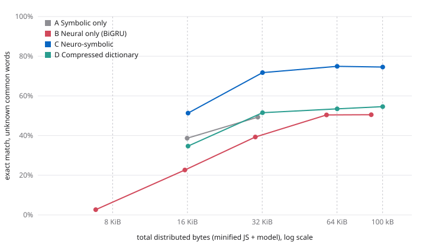

# tiny-furigana-food

[English](../README.md) | **日本語**

> 構成図・ビルドパイプライン・設定一覧: **[docs/ARCHITECTURE.md](ARCHITECTURE.md)**（mermaid） ・ 研究レポート: **[docs/REPORT.md](REPORT.md)**

**約 140 KB（100 KB 未満の小型版あり）で動く、食品名に特化した日本語の読み仮名（ふりがな）推定エンジン。** Pure TypeScript・依存ゼロ・WASM なし・完全オフライン。

> **研究段階です。** 食品名と地名に絞って精度を出しており、一般的な文章の読みには向かない。汎用の読み推定エンジンを名乗るほどではないため、名前に `-food` を付けている。

本研究は、食品の商品登録フォームでのふりがな自動入力を題材にしている。ただし、次の考え方は題材に依存しない。

- シンボリックな候補生成と、極小の学習スコアラーと、容量予算の中で選ぶ例外辞書を組み合わせる
- それぞれにバイト単位で容量を配分する

分野ごとの語彙（品名・地名・社名など）を持つ、ほかの入力補助にも流用できると考えている。

```bash
npm install @mrksye/tiny-furigana-food
```

```ts
import { createReader } from "@mrksye/tiny-furigana-food";

const read = await createReader();   // loads model.bin next to the module once
read("大根");          // "だいこん"
read("八街落花生");    // "やちまたらっかせい"
read("牛乳500ml");     // "ぎゅうにゅう500ml"
```

初期化後の `read` は同期・決定論的に動く。推定できない文字は削除も置換もせず、原文のまま返す。**結果はユーザーが手で直す前提**の設計になっている。

## サイズと精度

| 配布物 | 既定（バランス版 `R-135k-ct`） | 100 KB 厳守版（`R-100k-mf`） |
|---|---|---|
| `dist/tiny-g2p.min.js` | 8,589 B | 8,589 B |
| モデル | `dist/model.bin` 130,656 B | `dist/model-100k.bin` 91,396 B |
| **合計（非圧縮）** | **139,245 B** | **99,985 B** |
| gzip / brotli | 131,065 / 128,493 B | 93,645 / 91,940 B |

100 KB 版に切り替えるときは `createReader({ url })` に `model-100k.bin` の URL を渡す（使い方の節を参照）。

| 評価 | バランス版 | 100 KB 版 |
|---|---|---|
| 実在のキッチンカー商品名 64 件（非公開データ・学習には不使用） | **96.9%** | 89.1% |
| 仕様書の入出力例 18 件 | 15/18 | 10/18 |
| 有名な既知地名 | 88.4% | 55.7% |
| 既知語 | 98.5% | 94.7% |
| **未知語**（学習から除外した語。同じ設定を評価用データで学習したモデルで測定） | 74.9% | 75.4% |
| 未知の複合語（同上） | 80.3% | 80.6% |

長音の表記揺れ（じゅーす / じゅうす）は誤りとして数えない。
配布モデルは全データで学習しているので、未知語の数値は「学習から除外した版」で測っている。測り方の詳細は REPORT §6.11 を参照。
変更を入れるときは、正解率に加えて「前の版で正解だった入力が誤りに変わっていないか」を全評価セットで確認している（`research/tools/regress.ts`、REPORT §6.12）。
推論時間は 1 入力あたり約 13 µs、初期化は約 9〜17 ms（Bun 1.4.5、Linux）。ブラウザでは計測していない。

### 既存ライブラリとのサイズ比較

公開パッケージを取得して実測した（2026-11-25、npm / PyPI の最新版）。「読みに必要な部分」は、漢字の読みを出すのに要る解析器本体と辞書の合計。

| ライブラリ | 方式 | 読みに必要な部分 | 圧縮時 |
|---|---|---|---|
| **tiny-furigana-food**（既定 / 100 KB 版） | ルール + 線形 CRF + 例外辞書 | **139,245 B / 99,985 B** | gzip 131 KB / 94 KB |
| kuromoji.js 0.1.2（kuroshiro が使う解析器） | 形態素解析 + IPADIC | `dict/` 100.3 MB（展開後）+ `kuromoji.js` 308 KB | 配布時 gzip 17.8 MB + 67 KB |
| pykakasi 2.3.0 | 辞書引き | 9.9 MB（`kanwadict4.db` 9.75 MB） | wheel 2.4 MB |
| ipadic 1.0.0（MeCab 用辞書） | 形態素解析 | 52.9 MB | sdist 13.4 MB |
| SudachiDict-small 20261015 | 形態素解析 | 115.3 MB | wheel 42.5 MB |
| SudachiDict-core 20261015 | 形態素解析 | 202.3 MB | wheel 76.9 MB |
| unidic-lite 1.0.8（MeCab 用辞書） | 形態素解析 | 260.5 MB | sdist 47.4 MB |
| wanakana 5.3.1（参考） | かな⇔ローマ字のみ。漢字は読めない | 20,733 B | gzip 7.0 KB |

ブラウザで漢字を読めるもののうち最小の kuromoji.js と比べても、転送量は約 1/140 になる。
ただし上の形態素解析器は、大規模辞書によって一般語の読みをほぼ正しく出せる。tiny-furigana-food の未知語の正解率（約 75%）はそれに及ばない。
小ささと引き換えに、食品名と地名に絞って精度を確保している。
精度は同じデータで比較していない。

## 仕組み

```
NFKC 正規化 → 文字種判定 → 候補ラティス（単漢字の読み候補・連濁/促音/半濁の任意適用・例外辞書）
           → 線形ハッシュ特徴量によるスコアリング（CRF で学習、int4）→ Viterbi → ひらがな
```

シンボリック層・極小ニューラル（線形）層・辞書のみ・ニューラルのみの 4 方式を、同じ容量予算と同じ評価データで比較した。その結果と技術選定の理由は **[docs/REPORT.md](REPORT.md)** にまとめてある。主な知見は次のとおり。

- 正解はラティスの候補に 95% 含まれる。問題は「どれを選ぶか」で、効いたのは**候補 × 文脈の連言特徴量をハッシュで引く線形 CRF**だった。同じパラメータ数なら MLP は線形に勝てなかった。
- 例外辞書は既知語に効き、重みは未知語に効く。容量を 200 KB まで広げても未知語は 75〜76% で横ばいで、追加容量が効くのは食品語・地名の記憶だった。その効果も 135 KB で飽和する。
- 実利用で効いたのはデータの穴埋めだった。カタカナ読みの語（餃子・烏龍茶）の回収、語釈による食品語の判定、郵便番号データの市区町村名とその語幹（宇治・十勝）を入れたことが大きい。
- 正準ハフマン符号化・MSE 最適の量子化スケール・事前スコアの廃止（候補の並び順で代用）によって、同じ精度のまま約 30% 縮んだ。



## ディレクトリ

使うだけなら `src/` と `dist/` だけ見ればよい。依存は `src` ← `train` ← `research` の一方向で、`src/` は他のディレクトリを読まない。

```
src/         ライブラリ本体（ブラウザで実行）。公開 API は reader.ts
dist/        配布物（tiny-g2p.min.js・node.js・tiny-g2p.d.ts・model.bin・model-100k.bin・SIZES.json）
demo/        ブラウザデモ
tests/       bun test
train/       配布モデルを作る道具（Bun: 学習・例外辞書・符号化・バンドル、prep/: Python の前処理）
research/    研究と比較の一式
  runtime/   実験用の推論（二周ループ・ニューラルのみの方式 B）
  tools/     評価・回帰チェック・実験の実行・集計・図・ベンチ
  neural/    方式 B の学習（PyTorch）
  models/    比較用と配布候補のモデル
  data/eval/ 評価セット
  results/   全実験の結果（results.jsonl・experiments.md）・ログ・パレート図
docs/        研究レポート・アーキテクチャ・データの出典・日本語版 README（このファイル）
```

## 使い方

```bash
bun install
bun test                          # unit + release-model regression tests
bun run research/tools/serve.ts   # demo at http://localhost:8787/demo/
bun run research/tools/bench.ts   # init / latency / heap
```

### モデルの読み込み

`createReader()` は、モジュールと同じ場所にある `model.bin` を一度だけ読み込む。

- **ブラウザ**：`fetch` で取得する。バンドラーを使う場合は、`model.bin` がモジュールと同じ場所に配信されるようにするか、下の `url` / `data` で取得元を指定する。
- **Node / Bun / Deno**：`package.json` の `node` 条件で `dist/node.js` が選ばれ、ファイルから直接読む（Node の `fetch` は `file:` URL を読めないため）。ブラウザ向けのバンドルにはこの処理を含めていない。

取得元は `url` で、モデルのバイト列（`ArrayBuffer` か `Uint8Array`）は `data` で渡せる。

```ts
// 100 KB 版（Node）
const read = await createReader({ url: new URL("./model-100k.bin", import.meta.resolve("@mrksye/tiny-furigana-food")) });

// 自前で配信している URL から取得（ブラウザ）
const read2 = await createReader({ url: "/assets/model-100k.bin" });

// バイト列を渡す
const read3 = await createReader({ data: await (await fetch("/assets/model.bin")).arrayBuffer() });
```

学習から再現する手順は [docs/REPORT.md §10](REPORT.md#10-再現手順) にある。生データはリポジトリに含めていない。

## ライセンス

- **データ由来のファイル**（`dist/*.bin`、`research/models/*.bin`、`research/data/eval/*.tsv`）は JMdict・KANJIDIC2・JMnedict（© Electronic Dictionary Research and Development Group）に由来する。そのため [CC BY-SA 4.0](https://creativecommons.org/licenses/by-sa/4.0/) で配布する。アプリに組み込む場合は、出典の表示とライセンスへのリンクが必要。詳細は **[docs/DATA_SOURCES.md](DATA_SOURCES.md)** を参照。
- **ソースコード**（`src/`、`train/`、`research/` のコード、`tests/`、`demo/`）は [MIT](../LICENSE)。

This package uses the [JMdict](https://www.edrdg.org/wiki/index.php/JMdict-EDICT_Dictionary_Project), [KANJIDIC2](https://www.edrdg.org/wiki/index.php/KANJIDIC_Project) and JMnedict dictionary files. These files are the property of the [Electronic Dictionary Research and Development Group](https://www.edrdg.org/), and are used in conformance with the Group's [licence](https://www.edrdg.org/edrdg/licence.html). Per-character reading alignments come from [JmdictFurigana](https://github.com/Doublevil/JmdictFurigana).
