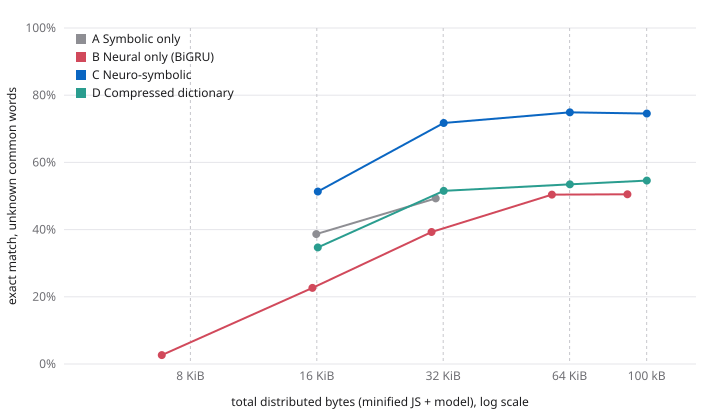

# 超軽量日本語 Neuro-Symbolic G2P エンジン 研究レポート

対象: ブラウザの商品登録フォーム向けふりがな自動入力。完全一致は必須ではなく、ユーザーが手で直すことを前提とする。
制約: 総配布容量 100,000 バイト未満 / Pure TypeScript / 実行時依存ゼロ / WASM・汎用推論ランタイム不使用 / 完全オフライン。
研究の途中で、容量の上限は利用者の判断で 200 kB まで緩和された（§6.10）。既定の配布物は 135 kB 版で、100 kB 未満の版も併せて配布している。

本レポートの数値は、すべて本リポジトリのスクリプトで実測したもの。生データは `research/results/results.jsonl` にあり、全実験の一覧は `research/results/experiments.md` にまとめている。

---

## 1. 結論

- **採用構成は C（ニューロシンボリック）**。シンボリックな候補生成と、ハッシュ特徴量の線形 CRF スコアラー（int3、QAT）を Viterbi 復号で組み合わせ、容量予算の中で選んだ例外辞書を持たせた。
- 配布物は2種類（§6.11、§6.12）。
  - **既定のバランス版 `R-135k-ct`**: 合計 139,245 B（JS 8,589 + model 130,656）
  - **100 kB 厳守版 `R-100k-mf`**: 合計 **99,985 B**（当初の制約内）
- **実在の商品名**（作者のキッチンカーのメニュー 64 件。学習には不使用）で、バランス版 **96.9%**（62/64）、100 kB 版 89.1%。長音の表記揺れ（じゅーす / じゅうす）は誤りに数えない（§6.14）。仕様書の 18 例はバランス版 15/18。
- 変更の採否は、正解率だけでなく「既存の正解を壊していないか」で判断した（§6.12）。CRF を学習し直すと、精度が同等でも答えの約 1 割が入れ替わる。そのため、後半の改良は**学習済みの重みを変えない形**（例外辞書の別枠追加）にとどめた（§6.12、§6.13）。
- 例外辞書そのものが、学習語 26,045 語の読みを壊していることも分かった。短い辞書項目が長い語を乗っ取っている（盛り=さかり が 大盛り の中に当たる）。修復用の別枠と、選択時の壊れチェックで一部を救った（§6.13）。
- **未知語**（学習から除外した語）は 75% 前後。容量を 200 kB に増やしても横ばいで、未知語の精度は容量ではなく候補選択の知識で決まっている。
- 実利用で効いたのは、容量の工夫より**データの穴埋め**だった。
  - カタカナ読み語の回収（6,620 語）
  - 英語の語釈から食品語を判定（7,981 語）
  - 郵便番号データの市区町村名と語幹
- 当初の 100 kB 研究フェーズ（§6.1〜6.10）の結論は次のとおり。
  - 全容量帯で C が最良
  - 同じパラメータ数なら MLP より線形が良い
  - 未知語には重み、既知語には辞書が効く
  - 8 KiB 帯はラティス方式の JS（約 8.4 KB）が収まらない

## 2. 制約の遵守状況

| 項目 | 状況 |
|---|---|
| 総配布容量 < 100,000 B | 100 kB 厳守版 99,880 B（JS 8,485 + model 91,395）。既定のバランス版は利用者の許可（〜200 kB）のもとで 135,083 B。`train/bundle.ts` が判定する |
| Pure TypeScript・ブラウザ推論 | `src/` は TypedArray と標準 API（`String.prototype.normalize`、`fetch`）だけを使う |
| 実行時依存ゼロ | `package.json` に runtime dependencies は無い（devDependencies は `typescript` と `bun-types` のみ） |
| WASM・ONNX・TF.js | 不使用 |
| Node 固有 API | `src/` では不使用（`node:fs` は `train/`・`research/`・`tests/` のビルド時だけ） |
| 外部 API | 実行時は不使用。モデルは同梱の `model.bin` を一度 `fetch` するか、バイト列を渡す |
| 決定論性 | 同じモデル・同じ入力なら常に同じ出力（`tests/release.test.ts` と `research/tools/bench.ts` で検証） |
| Bun | パッケージ管理・テスト・バンドルは Bun 1.4.5 |
| Python | 学習時のみ（データ前処理と方式 B の学習。Python 3.12.16、PyTorch 2.15.0+cpu） |

## 3. 既存手法と方針

- 一般的な日本語の読み推定は、形態素解析器と大規模辞書（MeCab・Sudachi・kuromoji など）か、ニューラル seq2seq を使う。どちらも本制約（100 kB）とは桁が違う。配布パッケージの実測では、最小の kuromoji.js でも辞書が展開後 100.3 MB（転送時 gzip 17.8 MB）、SudachiDict-core は 202.3 MB ある（README.ja.md「既存ライブラリとのサイズ比較」）。精度は同じデータで比較していない。
- 本研究では、WFST 型の G2P（候補生成 → 重み付き探索）の考え方を日本語の漢字読みに特化させた。そのうえで、重みを文脈依存の小さな学習モデルに置き換える構成を検証した。

## 4. データ

### 4.1 ソース

- JMdict・KANJIDIC2・JMnedict（EDRDG、CC BY-SA 4.0）
- 文字単位の読みアラインメントである JmdictFurigana（MIT。ただし元データ由来なので EDRDG ライセンスも及ぶ）
- 日本郵便の郵便番号データ KEN_ALL（著作権は主張されていない）。自動ダウンロードでは取得できなかったので、手動で取得した。研究の後半（§6.11）から使っている。
- 作者のアプリの実メニュー 76 件。評価専用で、学習には使わず、公開もしていない。

Wikipedia・Wiktionary は使っていない。詳細とライセンス上の含意は [`DATA_SOURCES.md`](DATA_SOURCES.md) にまとめた。

### 4.2 前処理（`train/prep/`）

- `parse_sources.py`: XML を TSV に変換する。
  - 除外: JMdict の不規則表記（rK/iK/oK/sK）と、全 sense が古語・稀用語のもの
  - 頻度タグ（news/ichi/spec/gai/nfXX）は 0〜5 の頻度クラスにまとめた
  - 読みがカタカナだけの語（餃子 など）は、語全体のスパンとして取り込む
  - 食品語の印は、JMdict の food 分野と英語の語釈から付ける（§6.11）
- `parse_kenall.py`: KEN_ALL から都道府県・市区町村（とその語幹）・町域を抽出する。
- `make_splits.py`: 学習用と評価用に分割する（§4.3）。
  - 重み: JMdict 語は頻度クラスに応じて 1〜12、副読みは ×0.3、「通常かな書き」は ×0.5。JMnedict の地名は 0.3（副読みは 0.1）。KEN_ALL は都道府県 5・市区町村 3・町域 0.1。
  - 出力は、評価用モデルの学習に使う `train.tsv` と、配布用モデルの学習に使う `train_all.tsv`（何も除外しない）。

### 4.3 分割とリーク対策

- **グループ単位の分割**: 単語は表層形ごと、地名は行政接尾辞（市・町・村・区・郡・駅・川・山・橋 など）を除いた語幹ごとにまとめた。箕面・箕面市・箕面駅は同じグループになる。グループは salt 付き MD5 で 4% をテストに割り当てた。
- **上位文字列の除去**: テスト語を部分文字列として含む学習項目はすべて削除した（最終版のデータで 81,214 件。KEN_ALL は別に 18,935 件）。たとえばテスト「冷凍」なら学習の「冷凍庫」を消す。逆に、テスト語の部分文字列にあたる学習語は残した。既知の部品から未知の複合語を読む力こそが、測りたい汎化性能だからである。
- **開発セット**: 学習データから 2,000 語を抜いた（`splitDev`、seed 7）。モデル選択はすべてこの開発セットで行い、テストセットは報告にだけ使った。
- **配布用モデル**（`R-` で始まる構成）は `train_all.tsv` で学習している。公開の評価セットは、このモデルにとってはリークしている。そのため、未知語の精度は同じ設定を `train.tsv` で学習した `C-` 構成で報告している。

### 4.4 評価セット（`research/data/eval/`、件数は最終版のデータ）

| セット | 件数 | 内容 |
|---|---|---|
| words_known | 3,000 | 学習済みの頻出語（既知語の再現） |
| words_unknown_common | 982 | 未知語・頻度クラス ≥ 2（**主指標**） |
| words_unknown_rare | 1,500 | 未知語・低頻度 |
| compounds_unknown | 1,128 | 未知語のうち、学習語 2 つ以上に分解できる 3 文字以上の語（未知複合語） |
| food_unknown | 355 | 未知語のうち食品語（food 分野・語釈判定）。初期は food 分野だけで 65 件だった |
| places_unknown | 3,000 | 未知地名（JMnedict の place/station） |
| places_known_famous | 1,000 | 学習済みの地名のうち、それを含む別の地名が 10 件以上あるもの（有名地名の代理指標） |
| place_products_synth | 1,000 | 未知地名 + 既知の食品語の**合成**（例: 未知地名 + バター）。連濁などの境界現象は考慮していない近似の正解 |
| kenall_towns_unknown | 1,500 | 学習から除外した KEN_ALL の町域名（公式の読み） |
| kenall_municipal_known | 1,000 | 学習に含まれる KEN_ALL の市区町村名 |
| kenall_products_synth | 1,000 | 既知の市区町村の語幹 + 既知の食品語の**合成**（例: 宇治 + 抹茶） |
| spec_examples | 18 | 仕様書の入出力例。学習から除外していない（§7.3） |
| menu_items / menu_items_clean | 76 / 64 | 実メニュー（非公開・評価専用）。clean は検索用の省略・別名・誤記と判断した 12 件を除いたもの。比較では空白を無視する |

指標は完全一致・別読み許容（JMdict/JMnedict に載っている別読みと一致すれば正解）・CER（編集距離 ÷ 正解の長さ）・Oracle（ラティスに正解の経路が存在する割合）。
長音記号「ー」と、それが表す母音のかな（じゅーす / じゅうす、こーひー / こうひい）は同じ読みとして扱う（§6.14 から）。

## 5. アーキテクチャ（方式 C）

```
入力 → NFKC 正規化 → 文字種判定 → 候補ラティス生成 → スコアリング → Viterbi → ひらがな
                     (src/kana.ts)  (src/lattice.ts,     (src/score.ts,  (src/decode.ts)
                                     src/phonology.ts)    src/features.ts)
```

### 5.1 シンボリック層

- **単漢字の読み候補表**: アラインメント済みデータで観測した読みを、KANJIDIC2 の音読み・訓読みの基底形に寄せる（`train/table.ts`）。たとえば「がっ」は「がく」の促音化、「ば」は「は」の連濁として扱う。基底形で説明できない読み（地名特有の読みなど）は、新しい基底として追加する。
  各漢字の候補は、上位 N 個と一定比率以上のものだけを残す。候補は頻度順に並べるので、**並び順そのものが事前分布になる**（§6.6）。
- **音韻規則**（`src/phonology.ts`）: 連濁・半濁音化・促音化は無条件には適用せず、**任意の候補**として生成する。
  隣接制約として「促音の次はカ・サ・タ・パ行」「半濁音化の直前は ん/っ」をデコーダで強制する。連濁は直前が漢字・ひらがな・カタカナのとき、促音化は直後が漢字のときだけ候補にする。
- **踊り字「々」**は直前の漢字の候補をコピーする。連濁も許可する。
- **漢字に挟まれた「ケ/ヶ」**（茅ヶ崎・旭ケ丘・一ヶ月）は「が・け・か」の候補にする。
- **例外辞書**: 2〜8 文字の語の読みを丸ごと持つ。ラティス上では複数文字にまたがるノードになる。
  - スコアラーが学習データで誤る語を、重み ÷ 符号長の大きい順に容量予算いっぱいまで選ぶ。
  - 配布構成では、食品語の重みを ×5、地名を有名度で重み付けしている。
  - 送り仮名を省いた表記（唐揚）は入れない。
- **候補が無い文字**（未知の漢字・絵文字・記号）は原文のまま出力する。カタカナはひらがなに変換し、英数字はそのまま残す。

### 5.2 スコアリング層

ノードのスコアは `varPen[v] + Σ w[hash(f) mod 2^b]`。v は変化の種類（連濁など）で、varPen はその加算値。遷移スコアは `Σ u[hash(g) mod 2^b']`。

- **放出特徴量** f: (読みの種別 × 変化の種類 × 前後の文字種)、(候補 × 前後の文字)、(候補 × 後続ひらがな 2 文字、つまり送り仮名)、(候補 × 漢字連続長 × 位置)、(順位 × 文脈)、踊り字。
- **遷移特徴量** g: (種別の組 × 変化の種類)、(前の候補 × 後の種別)、(前の末尾音 × 後の変化)、(促音 × 後の頭音)、(前の候補 × 後の候補)、(前の候補 × 後の頭音)。
- **学習**: ラティス CRF。正解は「アラインメントの読みを綴る全経路」とする潜在変数扱いで、forward-backward で勾配を計算し AdaGrad で更新する（`train/crf.ts`、TypeScript）。
  推論と**同じ特徴量関数を import している**ので、学習時と推論時の不一致が構造的に起きない。
- **量子化**: int3 / int4 の一様量子化で、スケールはクリップ率を探索して二乗誤差が最小になるように選ぶ。配布構成は int3 で、学習の最後に QAT を 1 エポック行う（§6.10）。

### 5.3 デコーダ

ラティス上の Viterbi で探索する。全候補の組み合わせを列挙することは無い。各位置に必ずノードが 1 つ以上あるので、経路は必ず存在する。

### 5.4 バイナリ形式（`src/codec.ts`）

記号列はすべて正準ハフマン（符号長 15 以内）で符号化する。

- 読みプールは前方一致圧縮。
- 漢字はコードポイント差分。
- 候補数・読み ID・種別はそれぞれ別のストリーム。
- 例外辞書は表層形の前方一致長 + 漢字インデックス + 読み。
- 重みは疎か密かを自動で選ぶ。疎の場合は、非ゼロ要素の位置の間隔と値をそれぞれハフマン符号化する。

### 5.5 配布モデルの内訳

| 要素 | 既定 `R-135k-ct`（bytes） | 100 kB 版 `R-100k-mf`（bytes） | 中身 |
|---|---|---|---|
| 候補表 | 20,142 | 19,648 | 漢字 3,000 字・候補 8,830 個・異なり読み 2,394 個。既定は助数詞の印（278 字）を含む（§6.14） |
| 例外辞書 | 66,528 | 27,762 | 既定は本体 + 別枠 3 種（§6.12・§6.13）+ 助数詞の語 10 個（§6.14）。100 kB 版は本体のみ |
| スコアラー | 43,986 | 43,986 | 放出 2^17 行 + 遷移 2^14 行、int3（QAT） |
| モデル合計 | 130,656 | 91,396 | |
| JS | 8,589 | 8,589 | minify 済み ESM（共通） |
| **配布合計** | **139,245** | **99,985** | gzip 131,065 / 93,645、brotli 128,493 / 91,940 |

既定の例外辞書の内訳は次のとおり。
- 本体（9,758 語）
- 送り仮名省略形の別枠（1 kB、122 語）
- 複合語で誤る語の別枠（1.5 kB、274 語）
- 辞書による破損の修復枠（1 kB、160 語）

2 つのモデルのスコアラーの重みは同一。

## 6. 実験

すべて開発セットで選択し、テストセットで報告した。乱数シード・設定・実行日時は `research/results/results.jsonl` に記録している。

### 6.1 方式の比較（同じ評価データ・同じ総容量）

総容量は JS と model の合計で、ラティス系の JS は 8,323 B、B の JS は 3,272 B。各容量帯で、開発セット最良の構成を載せた（候補構成の全結果は `research/results/experiments.md`）。

| 方式 | 構成 | 総バイト | 未知語 | 未知複合語 | 既知語 | 未知地名 | 地名+商品(合成) |
|---|---|---|---|---|---|---|---|
| A Symbolic | A-16k | 16,166 | 38.7 | 40.6 | 48.7 | 18.2 | 11.4 |
| A Symbolic | A-32k | 31,280 | 49.3 | 44.4 | 54.6 | 23.2 | 16.9 |
| B Neural | B-t8-q4 | 7,002 | 2.7 | 0.1 | 3.2 | 3.5 | 0.6 |
| B Neural | B-t16-q6 | 15,995 | 22.7 | 21.2 | 28.6 | 11.3 | 6.0 |
| B Neural | B-t32-q6 | 30,741 | 39.3 | 44.1 | 51.0 | 22.3 | 13.4 |
| B Neural | B-t64-q6 | 59,469 | 50.4 | 60.9 | 64.7 | 26.7 | 19.1 |
| B Neural | B-64k-q6 | 89,990 | 50.5 | 64.5 | 71.2 | 28.5 | 21.4 |
| **C Neuro-symbolic** | C-16k-d | 16,304 | **51.3** | **55.2** | **65.1** | **20.7** | **14.9** |
| **C Neuro-symbolic** | C-32k-a | 32,685 | **71.7** | **72.4** | **85.3** | **35.8** | **24.0** |
| **C Neuro-symbolic** | C-64k-a | 65,453 | **74.9** | **79.2** | **98.2** | **42.8** | **36.4** |
| **C Neuro-symbolic** | C-100k-h | 99,920 | **76.1** | **83.3** | **98.3** | **46.2** | **39.5** |
| D Dictionary | D-16k | 16,301 | 34.7 | 39.8 | 45.1 | 17.0 | 10.8 |
| D Dictionary | D-32k | 32,687 | 51.5 | 59.4 | 61.3 | 20.6 | 12.4 |
| D Dictionary | D-64k | 65,458 | 53.5 | 69.7 | 74.1 | 22.1 | 14.3 |
| D Dictionary | D-100k | 99,919 | 54.6 | 73.4 | 87.3 | 22.7 | 17.4 |

表の C-100k-h は開発セット基準で選んだ構成。最終リリースの C-100k-mq（§6.10）は、未知語 75.5・未知複合語 80.6・既知語 98.4・未知地名 42.1・地名+商品 36.2。下の図の C 系列の 100 kB 点は C-100k-mq を使っている。



- **A** は 32 KB で頭打ちになる。候補を増やすと Oracle は 95% まで上がるのに、選択を誤るので完全一致は 50% 前後にとどまる。64 KB 用に候補を増やした構成は、かえって開発精度が下がった（49.6% → 47.3%）。
- **B**（BiGRU、出力は文字ごとに最大 4 かな）は 8 KiB 帯に唯一収まるが、実用水準には遠い。100 kB 帯でも未知語 50% で、C の 16 KiB 帯と同程度。
- **D**（頻出語辞書 + 各漢字の第一候補読み）は既知語には強い。100 kB 帯で既知語 87%。ただし未知語は 55% で飽和する。
- **C** はすべての容量帯で最良。16 KiB → 32 KiB の伸びが最も大きく（+20pt）、その先は逓減する（32 → 64 KiB で +3pt、64 KiB → 100 kB で +1pt）。

### 6.2 容量と精度（C の候補構成）

16 KiB 帯ではモデルに使えるのが約 8 KB しかない。漢字 1,400 字 × 2 候補の候補表と、極小のスコアラー（放出 2^9 行）の組み合わせが最良だった。
32 KiB 帯以上では「候補表 → スコアラー → 例外辞書」の順に容量を割り当てるのが良かった。

| 帯 | 候補表 | スコアラー | 例外辞書 | 開発セット |
|---|---|---|---|---|
| 16 KiB | 5,681 | 302 | 2,001 | 52.4 |
| 32 KiB | 9,867 | 8,211 | 6,287 | 68.3 |
| 64 KiB | 18,898 | 16,409 | 21,829 | 76.4 |
| 100 kB | 18,898 | 58,593 | 14,106 | 78.3 |

### 6.3 例外辞書 vs スコアラーの重み

100 kB 帯で、候補表を固定して配分だけを変えた（`C-100k-a/c/d`）。

| 構成 | スコアラー | 辞書 | 開発セット | 既知語 | 未知語 | 未知複合語 |
|---|---|---|---|---|---|---|
| C-100k-d | 16.9 KB (2^15) | 53.9 KB | 76.1 | 98.1 | 74.8 | 80.7 |
| C-100k-a | 31.9 KB (2^16) | 40.8 KB | 77.1 | 97.9 | 75.3 | 82.5 |
| C-100k-c/h | 58.6 KB (2^17) | 14.1 KB | **78.3** | **98.3** | **76.1** | **83.3** |

辞書は学習語にしか効かず、既知語は 16 KB 分もあればほぼ飽和する。重みは未知語にも効く。容量に余裕が出たら、まず重みに回すべきという結果になった。

### 6.4 ニューラル構成の比較（最終コード・ハッシュパラメータ数 32,768 で統一）

| 構成 | モデル B | 開発セット | 未知語 | 未知複合語 |
|---|---|---|---|---|
| 線形 int8 | 53,078 | 75.8 | 75.3 | 77.2 |
| **線形 int4** | 35,307 | 75.1 | 74.8 | 75.7 |
| 線形 int3 | 31,017 | 73.5 | 74.4 | 73.2 |
| 線形 int2 | 26,342 | 68.5 | 68.8 | 67.2 |
| MLP 隠れ 4（2^13 行 × 4） | 29,863 | 73.4 | 73.3 | 75.7 |
| MLP 隠れ 8（2^12 行 × 8） | 29,426 | 57.1 | 57.0 | 54.2 |
| 原子特徴量のみ + MLP 16（文字埋め込みの和 → ReLU） | 28,764 | 57.0 | 57.3 | 54.2 |
| 原子特徴量 + 連言特徴量 + MLP 16 | 26,246 | 63.2 | 68.4 | 64.2 |
| 線形・放出の文脈特徴量なし | 21,961 | 56.9 | 55.9 | 52.6 |
| 線形・遷移特徴量なし | 32,624 | 66.1 | 66.7 | 66.5 |

- 同じ容量なら、線形 int4 か int3 が最も効率が良い。int4 を MLP 4 と同じバイト数に揃えた int3（31.0 KB）と比べても、MLP 4 は 73.4% 対 73.5% で優位は無い。
- MLP 8 と原子特徴量 MLP は 1 エポック目から損失が下がらなかった。ReLU が全部死んだ崩壊で、文脈特徴量なしの線形モデルと同じ精度になっている。学習率や初期化を調整すれば改善する可能性はあるが、本研究では深追いしていない。
- 文脈特徴量を外すと −18pt、遷移特徴量を外すと −9pt。知能の大部分は「候補 × 文脈」の連言に入っている。

方式 B（BiGRU）も事後量子化に弱い。int4 にすると int8 比で −8pt、int6 なら −1pt 程度だった。量子化を考慮した学習（QAT）は試していない。

### 6.5 重みの刈り込み

2^18 行の大きなモデルを学習してから、上位 k 個の重みだけを残して疎符号化した（`C-b18-*`）。

- 2 万重み（17.8 KB）で開発 68.6%。最初から 2^15 行で学習した密モデル（16.4 KB、74.2%）に大きく劣った。
- ハッシュモデルでは、小さい重みが束になって効いている。最初から小さく学習するほうが良い。

### 6.6 事前分布の扱い

候補ごとの 4 ビット事前スコアは、方式 A では一切効かなかった（開発精度は同じで、表だけ約 4 KB 増える）。候補が頻度順に並んでいて、同点のときは先頭が選ばれるためである。
C では、事前スコアの代わりに「順位 × 文脈」の特徴量を入れて事前スコアを捨てた。開発 75.6% 対 75.5% と同等で、3.2 KB 節約できた。

### 6.7 その他の試行（効果なし、または不採用）

| 試行 | 結果 |
|---|---|
| KANJIDIC の未観測読みを疑似カウントで追加 | 開発 −1.2pt、+4 KB |
| 学習エポックを 3 → 6 | エポック 3 で頭打ち（開発セット最良エポックを採用。同じシードなら結果は完全に一致し、再現性も確認できた） |
| 食品語の重みを ×3 | 開発 −1.4pt（food_unknown も 75.4 → 69.2%） |
| 地名の「有名度」（その地名を含む別地名の数）で重み付け | 学習と辞書の両方に適用: 有名既知地名 56.1 → 65.3% / 未知地名 46.2 → 43.9% / 開発 −0.6pt。辞書選択のみに適用: 有名既知地名 59.7% / 未知地名 44.0% / 開発は同等。トレードオフがあるので**不採用**（開発同点なら単純な構成を選ぶ規則に従った）。有名地名を重視する用途では `placeFameLex` を推奨 |
| 候補表 3,500 字 | 開発は同等、既知語 −2pt |

なお `C-lin-*`、`C-mlp*`、`C-b18-*`、`C-lin-test*` は探索初期の実験で、モデル形式 v1（ハフマン符号化なし）や旧特徴量で測っている。容量の数値は最終形式と比較できない。

### 6.8 シードによるばらつき（リリース構成、CRF のシード 1/2/3）

| 指標 | s1 | s2 | s3 |
|---|---|---|---|
| 開発セット | 78.3 | 77.0 | 78.0 |
| 未知語 | 76.1 | 75.6 | 76.4 |
| 未知複合語 | 83.3 | 83.3 | 83.5 |
| 未知地名 | 46.2 | 46.5 | 45.9 |

### 6.9 実行性能（Bun 1.4.5 / Linux x86-64、`research/tools/bench.ts`）

| モデル | 初期化（初回 / 中央値） | 1 入力あたり | ヒープ増加 |
|---|---|---|---|
| R-135k-rp1000（既定の配布版） | 18.8 / 8.6 ms | 13.2 µs | 約 3.3 MB |
| R-135k-okx1000（§6.12 時点の既定） | 17.2 / 8.8 ms | 12.8 µs | 約 3.2 MB |
| R-135k-mf（§6.11 時点の既定） | 19.4 / 8.4 ms | 12.7 µs | 約 3.2 MB |
| R-100k-mf（100 kB 版） | 13.2 / 5.1 ms | 12.5 µs | 約 1.5 MB |
| C-100k-mq（§6.10 時点のリリース） | 20.7 / 7.3 ms | 14.5 µs | 約 1.9 MB |
| C-100k-h | 15.0 / 6.3 ms | 16.6 µs | 約 1.0 MB |
| C-64k-a | 11.8 / 4.8 ms | 15.8 µs | 約 0.8 MB |
| C-32k-a | 7.4 / 2.3 ms | 11.1 µs | 約 0.1 MB |
| C-16k-d | 4.3 / 1.2 ms | 8.9 µs | 計測誤差以下 |
| A-32k | 5.6 / 2.5 ms | 10.0 µs | 計測誤差以下 |
| D-100k | 18.7 / 10.7 ms | 6.5 µs | 約 3.5 MB |
| B-t32-q6 | 5.6 / 2.7 ms | 39.6 µs | 計測誤差以下 |
| B-64k-q6 | 12.0 / 3.7 ms | 127.1 µs | 約 0.1 MB |

入力は評価セット 3 種（未知語・未知地名・地名+商品）の約 5,000 件 × 3 周。ヒープ増加は `bun:jsc` の heapSize の差分で、小さいモデルでは GC のゆらぎに埋もれる。
重みは Float32 に展開して保持しているので、メモリは配布容量の約 10 倍になる。
**ブラウザでの計測は行っていない**。デモページでは初期化時間と推定時間を表示するようにしてある。

### 6.10 容量拡張（〜200 KB）・QAT・リリース構成の見直し

最初の報告のあと、利用者から「精度を 90% 近くまで上げられないか。200 KB までなら許容」と依頼があった。そこで、100 KB 制約を外した追加実験を行った。

**容量を増やした場合**（合計は JS 8,323 B を含む上限。「地名重み」は §6.7 の有名度を辞書選択だけに使う設定）

| 構成 | 合計上限 | スコアラー | 地名重み | 開発セット | 既知語 | 未知語 | 未知複合語 | 未知地名 | 有名地名 | 仕様 18 例 |
|---|---|---|---|---|---|---|---|---|---|---|
| C-100k-h | 100 kB | 2^17 int4 | – | 78.3 | 98.3 | 76.1 | 83.3 | 46.2 | 56.1 | 9 |
| C-100k-hq | 100 kB | 2^17 int4 + QAT | – | 78.6 | 98.0 | 76.2 | 83.9 | 46.3 | 55.7 | 9 |
| C-100k-m | 100 kB | 2^17 int3 | ✓ | 77.0 | 98.4 | 75.2 | 81.7 | 42.3 | 91.7 | 11 |
| **C-100k-mq** | 100 kB | 2^17 int3 + QAT | ✓ | 77.6 | 98.4 | 75.5 | 80.6 | 42.1 | 91.8 | 11 |
| C-100k-k | 100 kB | 2^16 int4 | ✓ | 76.8 | 98.1 | 75.2 | 81.2 | 41.5 | 91.7 | – |
| C-115k-b | 115 kB | 2^17 int4 | ✓ | 78.0 | 98.4 | 75.7 | 82.5 | 43.4 | 91.8 | 11 |
| C-150k-a | 150 kB | 2^17 int4 | – | 78.2 | 98.1 | 75.6 | 84.1 | 46.1 | 56.3 | 9 |
| C-150k-b | 150 kB | 2^17 int4 | ✓ | 78.0 | 98.0 | 75.5 | 83.2 | 43.8 | 92.6 | 11 |
| C-200k-a | 200 kB | 2^18 int4 | – | 78.8 | 97.9 | 76.0 | 85.4 | 47.5 | 59.0 | 9 |
| C-200k-b | 200 kB | 2^18 int4 | ✓ | 78.6 | 97.9 | 75.8 | 84.5 | 43.6 | 92.8 | 11 |

- **未知語は 200 KB でも 76% で横ばい**。90% に届かせるには容量ではなく、別の情報源（地名データ・実利用データ）や別の候補選択の知識が要る。
- **追加容量の効果は「既知の固有名詞の記憶」**。地名を辞書に入れると、有名地名が 56% → 92% に上がる。その分の辞書は約 30 KB で、115 KB で飽和した。
  100 KB 内でも、スコアラーを int3 にして約 15 KB 空ければ同等になる（C-100k-m）。
- **代償**: 地名辞書のエントリが未知の地名や複合語の内部に一致して、未知地名は約 −4pt、未知複合語は約 −2〜3pt 下がる。
  辞書ノードのスコア（既定 4/文字）を 3〜−2 で振ったが、未知地名は改善せず、既知語と有名地名が下がるだけだった（`C-150k-b-ls*`）。
- **QAT**（学習の最後に 1 エポック、量子化した重みで順伝播し、勾配は浮動小数の重みに流す straight-through 方式）: int3 で開発 +0.6pt、int4 で +0.3pt。小さいが一貫してプラスだった。
- **リリース構成の変更**: 想定用途（地名を含む商品名）では有名地名の取りこぼしが目立つ。そこで、開発セットだけで選ぶ当初の規則から、「開発 −0.7pt と引き換えに有名地名 +36pt」を取るバランス判断に変えて、`C-100k-mq` を採用した。100 KB 制約はそのまま守っている。
- この時点では日本郵便のデータと実際の商品名データが未取得だった。どちらも §6.11 で取り込んだ。

### 6.11 郵便番号データ・実利用データの導入と配布用モデル

§6.10 のあと、日本郵便の KEN_ALL と、作者のアプリの実メニュー 76 件（読み取り専用で取得、評価専用、非公開）が手に入った。
そこで、実利用での精度を主指標に加えて改良した。

§6.1〜6.10 の数値は、この節のデータ改良より前の版の学習データで測ったものである。評価セットの一部（未知語・未知複合語）は、カタカナ読み語の回収で件数が少し変わっている（例: 未知語 980 → 982 件）。

**データの改良**
1. **KEN_ALL の取り込み**（`train/prep/parse_kenall.py`）
   - 都道府県 47・市区町村 2,693・町域 84,328 件を抽出した。注記行・括弧書き・番地系は除外した。
   - 文字単位の読み対応が無いので、`train/align.ts` で候補表に強制アライメントした。候補に無い読みは1字までなら新しい候補として採用し、98% が整列できた。
   - 学習の重みは都道府県 5、市区町村 3、町域 0.1。
   - 「宇治市 → 宇治」のように**市町村名の語幹**も読み付きで追加した。商品名は語幹の形で使われるためである。
   - 漢字に挟まれた「ケ/ヶ」は「が・け・か」の候補にするシンボリック規則を加えた（茅ヶ崎・旭ケ丘）。
2. **カタカナ読み語の回収**: JmdictFurigana は読みがカタカナだけの語（餃子 ギョーザ、烏龍茶 ウーロンちゃ）を含まない。そのため、それまで学習データから 6,620 語が丸ごと抜けていた。これを語全体のスパンとして回収した。ひらがなの検索用表記（sK）があればそれを優先し、餃子は「ぎょうざ」にした。
3. **食品語の判定**: JMdict の food 分野タグは約 1,600 語にしか付いていない。そこで、英語の語釈に食品系の英単語（tea・roe・scallop・gizzard・noodle など）を含む語にも印を付けた（7,981 語）。例外辞書を選ぶときの重みを ×5 にしている（`foodLex`）。
4. **送り仮名省略表記の除外**: 「唐揚（からあげ）」が辞書にあると、「唐揚げ」が「からあげげ」になる。送り仮名付きの表記と読みが同じになる省略表記は、辞書に入れないようにした。
5. **配布用の学習データ**（`train_all.tsv`）: 評価用の除外をせず、全データで学習する。公開の評価セットは、このモデルにとってはリークしているので使わない。未知語の数値は同じ設定を `train.tsv` で学習した C 系列で測り、実メニューの数値は配布用モデルで測った。

**結果**（メニューはクリーン版 64 件。表記揺れのない明確な誤ラベル 12 件を除外したもの。未知語は C 系列で測定）

| 構成 | 合計 | 実メニュー（64 件） | 仕様 18 例 | 有名地名 | 既知語 | 未知語（C 系列） | 未知複合語（C 系列） |
|---|---|---|---|---|---|---|---|
| C-100k-mq（§6.10 のリリース、KEN_ALL 導入前の学習） | 100 kB | 71.9 | 11 | 91.8 | 98.4 | 75.5 | 80.6 |
| R-100k-mf | **99,880 B** | 84.4 | 10 | 55.7 | 94.7 | 75.4 | 80.6 |
| R-115k-mf | 115 kB | 87.5 | 13 | 61.8 | 97.6 | – | – |
| **R-135k-mf（既定）** | **135,083 B** | **87.5** | **14** | **88.2** | **98.3** | 74.9 | 80.3 |
| R-150k-mf | 150 kB | 87.5 | 14 | 89.2 | 98.3 | – | – |

- **データの穴埋めが最大の改善**だった。同じ 100 kB のまま、実メニューが 71.9 → 84.4%（+12.5pt）になった。
- 100 kB では、食品語と地名が辞書の枠を取り合う。135 kB で両方がほぼ飽和し、それ以上は地名が +1〜4pt 増えるだけだった。そこで **135 kB を既定**にして、100 kB 版を併せて配布することにした。
- 実メニューの残りの誤りは次のとおり。
  - 正解データの表記揺れ: 「じゅうす/じゅーす」など 3 件
  - 料理分野固有の読み: 1 件
  - 送り仮名なしの「焼」: 焼そば → やそば
  - 「盛合せ」の読み、促音化の判断、低頻度の食品語
- **注意**: メニュー評価は 64 件しかなく、1 件で 1.6pt 動く。正解はアプリの検索用読み（人手か生成かは不明）で、表記に揺れがある。傾向を見るための指標として扱うべきもの。

### 6.12 二周ループ・促音特徴量・送り仮名省略 ― 「既存の正解を壊さない」評価

§6.11 のあと、利用者から次の3つの提案があった。
- 宇治抹茶・落花生の促音化をなんとかしたい
- 焼そばのような送り仮名の省略に対応したい
- シンボリック→ニューラル→シンボリック→ニューラルの2回ループ（いったん単語の塊に区切ってから読み直す）を試したい

あわせて「精度が上がることより、既存の正解が誤りに変わっていないかが重要」という評価方針が示された。
そこで `research/tools/regress.ts` を作った。2 つのモデルの出力を全評価セットで突き合わせて、直った件数（誤→正）と壊れた件数（正→誤）を数える。

**試した方法**
1. **促音特徴量**（基底読みの末尾 × 促音化 × 次の頭音 × 読みの種別）: 未知語 +1.0pt、未知複合語 +1.3pt、開発 +0.8pt（`C-135k-*`、評価用データでの学習）。
   ところが、旧リリースとの突き合わせでは、直った 385 件に対して**壊れたのが 374 件**あった。仕様書の例（冷凍枝豆）や実メニュー（焼ラーメン・帆立バター焼き）も壊れている。
   原因の大半は特徴量そのものではなく、**学習し直しによる重みの入れ替わり**だった。**不採用**とし、コードからも外した。
2. **二周ループ**（`research/runtime/chunk.ts`、`research/runtime/decode2.ts`、`research/runtime/reader2.ts`）: 漢字の連なりを単語の塊に区切り、塊ごとに単独の入力として読み直す。
   - 区切りの判定は、学習語彙を連結した合成データ（地名+食品、語+語など）で学習した極小の線形モデルで行う。
   - 区切り位置が正しければ、という上限は、未知複合語 81.6 → 89.5%、市区町村+食品 68.4 → 81.2% だった。
   - 実際の区切り判定では、壊れる件数が多かった。

| 区切り方（同じ CRF 重み） | 直った | 壊れた |
|---|---|---|
| 塊を完全に独立させる | +163 | −130 |
| 単語らしさの特徴量だけ塊ごと（連濁・遷移は境界をまたぐ） | +108 | −140 |
| 上記 + 点数で採否を判定 | +79 | −74 |
| ひらがなの前でも区切る（焼｜そば） | +115 | −159 |
| 確信度しきい値 1 / 2 / 3 | +99 / +37 / +10 | −79 / −31 / −17 |
| 例外辞書の語の端だけで区切る | +6 | −14 |

   - 壊れたのは主に、4 文字以上の未知の地名を誤った位置で区切るケース。
   - 塊をまたぐ連濁が失われるケース（練習｜試合 → しあい）や、送り仮名の手前で区切るケース（走｜りすぎる）もあった。
   - 商品名（市区町村+食品）には効いた（しきい値 1 で +19 / −4）。ただ、全体の「壊さない」基準は満たせなかった。そこで既定の配布物には入れず、研究用のエントリ（`createReader2Loop`）として残した。
3. **送り仮名省略の補完**（`okuriganaVariants`）: KANJIDIC の訓読み（や.く・も.る・あ.わせる）に照らして、連用形の送り仮名だけを省いた表記を作る。たとえば焼きそば → 焼そば、盛り合わせ → 盛合せ。
   - CRF の学習データに加えた場合（再学習あり）: 実メニュー +3、ただし全体で +571 / −612。
   - 例外辞書の候補に混ぜた場合（容量は固定）: 押し出された語が壊れる（重み 0.2 で +5 / −6、重み 1 で +48 / −87）。
   - **例外辞書に別枠（+1 kB）で追加**（既存の辞書項目は一切動かさない）: **+4 / −0**。焼そば・焼鳥盛合せが直った。**採用**。
   - 最初の版では「漢字の後のひらがなを1字消す」だけだったので、茶しぶ → 茶ぶ のような不正な形が生まれ、それが辞書に入って誤りを起こした。KANJIDIC の訓読みに照らす現在の方式に直してからは発生していない。

**容量の扱い**
- 研究用コードを既定のバンドルから外して、JS を 8,513 B（前の版 +28 B）に戻した。モデル形式 v3 で追加した 1 バイトは例外辞書の予算から除いた。
- そのうえで 100 kB 版は、前の版と**完全に同じ出力**（変化 0 件）のまま 99,909 B に収めた。
- 100 kB 版に送り仮名省略の別枠を入れると予算を超える。予算内に収めると辞書の押し出しで壊れる（+13 / −11）。そのため、100 kB 版には入れていない。

**知見**
- 精度が同等の CRF でも、学習し直すと評価セットの答えの約 1 割が入れ替わる。平均の正解率だけで改良を判断すると、利用者が覚えている「前は読めた語」が壊れる。
- 既存の正解を守りたい改良では、学習済みの重みを変えずに、例外辞書へ足し込む方式が安全だった。
- 二周ループの効果は商品名のような「語＋語」に集中する。地名の内部を誤って区切らないように、区切り判定に地名の知識を持たせることが次の課題になる。

### 6.13 複合語で誤る語と、辞書による破損の修復

§6.12 のリリースでも、次のような商品名が誤っていた（利用者の指摘）。
- 宇治抹茶ラテ → うじまつちゃらて
- 生姜焼き生ビール、生姜入り生ビール → …いびーる
- 大盛り定食 → おおさかりていしょく

原因は2種類あった。
- 単独なら正しく読める語が、前に地名や送り仮名で終わる語が付くと、スコアラーの判断が僅差で逆転する。例外辞書は「単独で誤る語」だけを選ぶので、入っていない。
- 例外辞書の短い項目が長い語を乗っ取る（盛り=さかり が 大盛り の中に当たる）。調べると、**例外辞書のせいで学習語 26,045 語の読みが壊れていた**。

どちらも、学習済みの重みは変えず、例外辞書に別枠を足す形で対処した（`train/lexicon.ts`）。
1. **複合語で誤る語の別枠**（`selectCompoundRobust`、1.5 kB）
   - 対象: 単独では正しく読めるのに、前置きを付けると誤る語。
   - 前置き: 市区町村の語幹 30 種、送り仮名で終わる食品語 15 種。
   - 壊れチェック: 候補を足したときに、その語を含む学習語が誤るなら採用しない。煎り豆腐 → いりとうふ（豆腐の連濁が消える）、ひな菓子 → ひなかし、太巻き → ふとまきき を、この段階で除外できた。
2. **辞書による破損の修復枠**（`selectRepairs`、1 kB）
   - 対象: 辞書なしでは正しく読めて、辞書ありでは誤る学習語。
   - その語自体を項目として足し、長い一致を優先させる。

| 追加（§6.12 の版との差分） | 直った | 壊れた |
|---|---|---|
| 複合語の別枠（壊れチェックなし、1.5 kB） | +46 | −5 |
| 複合語の別枠（壊れチェックあり、1.5 kB） | +47 | −3 |
| + 修復枠 1 kB（**採用**） | **+140** | **−3** |
| + 修復枠 2 kB | +186 | −3 |

- 直った内訳は、市区町村名 +44、市区町村+食品 +54、地名+食品 +21、既知語 +7、仕様の例 +1（宇治抹茶）。
- 壊れた 3 件は、いずれも合成データ（地名+食品）で、別枠の語が地名との境目をまたいで当たったもの（桐生玉子 → 桐｜生玉子 など）。
- 100 kB 版は変更していない（前の版と出力が同一）。
- 「大盛り」は修復枠 2 kB の版では直るが、容量を抑えるため 1 kB を採用した。

**不採用にした規則: 送り仮名が必須の語幹**

「カタカナ語の前で送り仮名扱いになるのはおかしい（生ビール → いびーる）」という指摘を受けて、シンボリックな制約を試した。
- 規則: 語の末尾に来ることがほぼ無い訓読みの語幹（生=い）は、カタカナの語の直前では候補にしない。
- 判定方法: KANJIDIC で送り仮名付きの形しか持たず、かつ学習データで直後が文末・カタカナになる割合が 2% 以下のものに印を付ける（428 個）。
- 試行の経過:
  - 最初は「直後が 98% ひらがな」を基準にした。生駒（いこま）のように、地名では直後に漢字が来るので、生=い に印が付かなかった。
  - 次に「文末の前」も制約に含めた。花見（はなみ）のような語末の語幹を壊した。
  - 次に「KANJIDIC の語幹のみ」を基準にした。富士見（ふじみ）+ カタカナ商品名を壊した。
  - 最終形は「語の末尾に来ない読み × カタカナ語の直前」で、+2 / −1 だった。
- 例（生姜焼き生ビール）は複合語の別枠ですでに直っていた。効果が小さいわりに印の情報で +434 B かかるので、**不採用**とした。考え方としては正しく、辞書に頼らない汎化には有効（辞書なしでも 生姜焼き生ビール → …なまびーる になる）。

### 6.14 長音の扱い・数字＋助数詞・ひらがな表記

**評価規則の変更: 長音の表記揺れ**

実メニューの残りの誤り 6 件のうち 3 件は、長音の書き方の違いだった（ジュース: 正解 じゅうす / 出力 じゅーす、チューハイ: ちゅうはい / ちゅーはい）。
- 正解データの中でも揺れていた。同じチューハイが、レモンチューハイでは ちゅーはい、缶チューハイでは ちゅうはい になっている。「ー」を含む正解 21 件のうち 18 件は「ー」のまま書かれている。
- そのため、出力側を「う」に変換する後処理は入れなかった（18 件を逆に壊す）。用途は検索用のふりがななので、どちらでも引ける。
- 評価では「ー」と、直前のかなの母音（お段なら う も、え段なら い も）を同じ読みとして扱うようにした（`research/tools/evaluate.ts` の `sameReading`、`research/tools/regress.ts` と `research/tools/errors.ts` も同じ規則）。
- これで実メニューはバランス版 90.6 → 95.3%、100 kB 版 84.4 → 89.1% になった。モデルは変えていない。公開の評価セットの値は変わらない。`research/results/experiments.md` の過去の行は旧規則で測ったままである。

この時点の残りの誤りは 3 件（いか下足焼き → いかしもあしやき、おつまみ3種 → おつまみ3たね、青菜炒め → あおないため）。青菜（ちんさい）は中国語読みで、あおな も日本語として正しいので対象外とした。

**採用: 算用数字の後の助数詞（`counters`、`R-135k-ct`）**

3種 → 3たね は、数字が語の切れ目のように扱われ、種 が語頭の訓読み（たね）になるために起きる。重みを変えないシンボリックな規則で直した。

漢数字に置き換えてから読む方法は使えなかった。今のモデルでも 三種 → みたね（地名の三種町）、三合 → みあい、二名様 → になさま と読む。

1. **1 字の助数詞**（3種、2杯、3合）
   - 辞書から読みを集めた。漢数字が数として読まれている語（三種 さん|しゅ、二杯 に|はい）で、直後の漢字がどの候補の読みで読まれているかを数える。連濁・促音は元の読みに戻して数える（三杯 ばい → はい）。
   - 3 回以上現れ、その漢字の後続読みの 60% 以上を占める読みを助数詞の読みとした（278 字: 種=しゅ、人=にん、杯=はい、合=ごう、個=こ、本=ほん など）。
   - その漢字の他の候補に印を付けた。印は候補の分類（音・訓・その他）の空きビットに入れ、特徴量からは除いている。
   - 読むときは、算用数字の直後の漢字で、後ろにひらがなが続かない（3切れ は対象外）ものに限り、印の付いた候補を落とす。残った候補の連濁などの変化と、後ろに続く漢字の読みは従来どおり CRF が選ぶ（3人前 → 3にんまえ、5本入り → 5ほんいり）。
2. **助数詞の語**（盛り、名様、番目）
   - JMdict で助数詞（品詞 ctr）とされている 2〜4 字の語のうち、数字の後で誤って読まれるものを、目印（U+0001）付きで例外辞書に入れた（10 語、盛り=もり、名様=めいさま など）。
   - 目印付きの語は、数字の直後と、数字の直後の漢字の次（3種|盛り、3点|盛り）でだけ当たる。普通の 盛り（さかり）や 大盛り には影響しない。
   - JMdict の 1 字の助数詞の読みは当てにならない（袋=たい、本=もと、種=くさ）ので、1 字は 1. の統計だけを使った。

結果
- 3種 → 3しゅ、3種盛り → 3しゅもり、3点盛り → 3てんもり、2名様 → 2めいさま、3人前 → 3にんまえ、2杯 → 2はい、3合 → 3ごう。
- 全評価セットで +2 / −0（実メニューの おつまみ3種 のみ。評価セットに数字を含む入力はほとんど無い）。
- 参考として、辞書の「漢数字 + 漢字」の語 3,086 語を算用数字に置き換えて読ませると、正解率は 49.9 → 62.4%（+420 / −32）だった。印を作ったのと同じ辞書なので、楽観的な値である。壊れた例は 1巻 まき → かん、1時 とき → じ など、数字表記ではむしろ自然なものが多い。
- 印と語の分（+560 B）は例外辞書の予算から差し引かず、上乗せにした。差し引くと、辞書が 400 B 減って無関係な地名が崩れた（+6 / −5）。

途中で不採用にした形
- 数字の後に続く漢字にも印を当て続けると、3年生 → 3ねんしょう、1時間 → 1じけん のように崩れた（+419 / −91）。
- 1 字の助数詞も例外辞書の項目にすると、CRF が後ろの漢字を文脈から選べなくなり、1時間 → 1じま、3人前 → 3ひとまえ になった。

JS とサイズ
- JS は +66 B。デコーダの 3 種類のエラーメッセージを 1 つにまとめ、ノード生成の重複をまとめ、空入力の不要な分岐を除いて、規則の分を相殺した。
- 100 kB 版はモデルを変えずに 99,975 B に収まり、出力の変化は 0 件。

**不採用: 算用数字の学習データ（`digitAug`、`R-135k-dg`）**

辞書は数を漢数字で書く（三種 さんしゅ）が、メニューは算用数字で書く（3種）。学習データで算用数字から始まる語は 631 語しかない。
- 漢数字 + 漢字の語から、算用数字に置き換えた例を 2,838 語作って CRF の学習に加えた（数字はそのまま読み、助数詞は元の読み: 一本 いっぽん → 1本 1ぽん）。
- 3種 → 3しゅ、3人前 → 3にんまえ は直った。
- しかし CRF の学び直しで答えが入れ替わり、全評価セットで +501 / −614 だった。実メニューでも 焼ラーメン → やらーめん、大阪肝焼き → おおさかぎもやき が壊れ、仕様書の例も 八街落花生 を落とした。**不採用**とした。
- 学習し直さずに、文脈特徴量の中だけ算用数字を漢数字とみなす方法も試した。3種 は 三種（地名 みたね）と同じに見えるため、直らなかった。

**不採用: カタカナ始まりの辞書項目をひらがなでも引く**

学習データの「イカ下足（いかげそ）」はカタカナの イカ 付きしかなく、メニューの「いか下足焼き」には当たらない。
- 例外辞書の引き方をカタカナ・ひらがな区別なしにすると、南ア（南アフリカ）が 南あわじ に、四つ が 四ツ屋 に当たって 12 件壊れた。
- カタカナで始まる項目だけをひらがなでも引けるようにすると、いか下足焼き は直るが、イト沢 が いと沢（いとさわ）に当たって 1 件壊れた（+1 / −1、実メニューを除けば +0 / −1）。
- 食品語のひらがな表記を別枠で辞書に足す方法（300 B）は、選ばれたのが かき灰・の米偏 などで、いか下足 は入らなかった。
- いずれも効果が 1 語にとどまるので、**不採用**とした。

## 7. 誤り分析（既定の配布構成）

未知語に関する数値は、配布版と同じ設定を `train.tsv` で学習した `C-135k-mf` で測った。実メニューと仕様の例は配布版 `R-135k-mf` で測った。

### 7.1 傾向

- **未知語**: 74.9%（別読み許容なら 78.0%）、CER 13.3%。未知複合語は 80.3%。
- **地名**:
  - 有名既知地名は 89.1%（別読み許容なら 94.4%）、KEN_ALL の既知市区町村名は 84.5%
  - 未知地名は 40.6%、KEN_ALL の未知の町域名は 30.3%
  - 学習していない地名は、今もこの方式の弱点である
- **実メニューの残りの誤り**（§6.11。焼そば・盛合せは §6.12 で解消）:
  - 送り仮名を省いた「焼」の後にカタカナが続く形（焼ラーメン → やらーめん）
  - 促音化の判断
  - 低頻度の食品語
- **熟字訓・当て字**: 例外辞書に入らなかった語は読めない（Oracle 外）。
- **促音化・連濁の判断ミス**: 宇治抹茶 → うじまつちゃ、予防接種 → よぼうせつしゅ。
- **候補表に無い漢字**: 宥・灼・佇（常用外）は原文のまま残る。仕様どおりの動作。

### 7.2 Oracle

未知語のラティス Oracle は 94.6%。誤りの大半は「候補はあるのに選び間違えた」もので、スコアラーにはまだ改善の余地が大きい。

### 7.3 仕様書の 18 例

**既定リリース R-135k-rp1000 では 15/18。** 誤りは次の 3 例だった（宇治抹茶は §6.13 で解消）。

| 入力 | 期待 | 出力 |
|---|---|---|
| 越後味噌 | えちごみそ | えちあとあじそ |
| 喜連瓜破 | きれうりわり | きれうりは |
| 放出 | はなてん | ほうしゅつ |

以下の表は、§6.10 時点のリリース C-100k-mq での結果。

#### C-100k-mq

| 入力 | 期待 | 出力 | | 学習データに含まれるか |
|---|---|---|---|---|
| 大根 | だいこん | だいこん | ✓ | yes |
| ビール | びーる | びーる | ✓ | – |
| 豚バラ肉 | ぶたばらにく | ぶたばらにく | ✓ | yes |
| 冷凍枝豆 | れいとうえだまめ | れいとうえだまめ | ✓ | – |
| 生姜焼き | しょうがやき | しょうがやき | ✓ | yes |
| 玉葱 | たまねぎ | たまねぎ | ✓ | yes |
| 木耳 | きくらげ | きみみ | ✗ | yes |
| 海老 | えび | えび | ✓ | yes |
| 生ビール | なまびーる | なまびーる | ✓ | yes |
| 箕面ビール | みのおびーる | みのおびーる | ✓ | 箕面のみ（地名） |
| 越後味噌 | えちごみそ | えちあとあじそ | ✗ | 越後のみ（地名） |
| 近江牛 | おうみぎゅう | おうみうし | ✗ | yes |
| 十勝バター | とかちばたー | とかちばたー | ✓ | 十勝のみ（地名） |
| 宇治抹茶 | うじまっちゃ | うじまつちゃ | ✗ | 宇治・抹茶 |
| 八街落花生 | やちまたらっかせい | やちまたらくかせい | ✗ | 八街のみ（地名） |
| 喜連瓜破 | きれうりわり | きれかは | ✗ | 喜連のみ（地名） |
| 放出 | はなてん | ほうしゅつ | ✗ | yes（地名と一般語の両方） |
| 牛乳500ml | ぎゅうにゅう500ml | ぎゅうにゅう500ml | ✓ | 牛乳 |

11/18 例が正解（旧リリース C-100k-h は 9/18）。個別のハードコードはしていない。
残りの誤りは、促音化の判断（抹茶・落花生）、地名ではない読み（越後の「後」）、複合語内の音読み（近江「牛」）、熟字訓（木耳）、一般語と地名の曖昧性（放出）。

## 8. 限界と今後

1. **未知語の精度**: 未知語は容量を増やしても 75% 前後で頭打ちになる（Oracle は 95%）。候補選択の知識を増やすには、文脈特徴量の設計を見直すか、学習データを増やす必要がある。品詞的な情報や、語構成の規則などが候補になる。
2. **未知の地名**: 町域名など、学習していない地名は 30〜40% にとどまる。地名専用の読みの傾向を、別の特徴量として持たせる余地がある。
3. **実利用データの規模**: 実メニューの評価は 64 件で、正解は検索用の読みなので表記にも揺れがある。人手で付けた、より大きな評価セットがあれば判断の精度が上がる。
4. **メモリ**: 重みを Int8 のまま保持すれば、メモリを約 1/4 にできる（容量には影響しない）。
5. **ブラウザでの実測**: 初期化時間と推論時間を、主要ブラウザで計測していない。
6. **評価の限界**: 合成の評価セット（place_products_synth・kenall_products_synth）は、境界での連濁などを無視した近似の正解になっている。
7. **MLP の崩壊**: 初期化・学習率・正規化を調整すれば、MLP が線形に並ぶか上回る可能性はある。本研究の比較は「標準的な設定での一回の試行」にとどまる。
8. **方式 B の QAT**: BiGRU は事後量子化だけで比較している。QAT を入れれば、B の数値は改善する可能性がある。

## 9. 研究の経過（時系列）

1. データを調査・取得した。JMdict・KANJIDIC2・JMnedict・JmdictFurigana は取得できたが、郵便番号データは自動ダウンロードでは取得できなかった（後に手動で取得し、13 で導入）。
2. 方式 A（単漢字候補 + 頻度 + 音韻規則）のベースラインを作った。未知語 49%・Oracle 94% で、「候補はあるが選べない」ことが分かった。
3. 線形ハッシュ CRF（方式 C）を入れた。未知語は 49% → 73%。誤りを分析して、カタカナ後の連濁・促音の遷移特徴量を追加した（+1pt）。
4. 例外辞書を入れた。既知語は 86% → 98% に上がったが、未知語はほぼ変わらなかった。
5. 同じ容量で MLP と線形を比べた。線形が優位だった。
6. 形式を v2 にした（ハフマン符号化・MSE 最適スケール）。候補表は 30 KB → 22 KB、スコアラーは 37 KB → 29 KB に縮んだ。
7. 刈り込みを試したが効果は無かった。方式 D を実装した。
8. 方式 B（PyTorch BiGRU）を作った。TS 推論でアルファベットのサイズを数え間違えるバグがあって最初は 0% になり、修正後に再評価した。
9. 事前スコアを捨てて順位特徴量に置き換えた（−3 KB）。容量帯ごとに配分を探索した。
10. 地名の有名度重み付けを試したがトレードオフがあり不採用。踊り字の特徴量を追加した。
11. 最終コードで全容量帯の構成とアブレーションを再学習した。シードによるばらつきを測り、バンドル・テスト・ベンチ・デモを整備した。
12. 利用者の依頼（〜200 KB 許容、90% 目標）を受けて容量拡張を実験した。未知語は横ばいで、追加容量は地名の記憶に効き、115 KB で飽和することが分かった。
    QAT を実装し、100 KB 内のバランス構成 C-100k-mq をリリースに採用した。
13. KEN_ALL と実メニュー（評価専用）を導入した。カタカナ読み語の回収・食品語の判定・市町村語幹・送り仮名省略表記の除外を行い、全データ学習の配布用モデルを作った。実メニューは 71.9 → 87.5% に上がった。
    既定を 135 kB のバランス版に変えて、100 kB 厳守版も併せて配布することにした。
14. 促音特徴量・二周ループ（単語の塊に区切って読み直す）・送り仮名省略の補完を試した。「既存の正解を壊さない」評価（`research/tools/regress.ts`）を導入したところ、再学習による答えの入れ替わりが大きいことが分かった。
    重みを変えずに例外辞書の別枠へ送り仮名省略形を足す方式だけを採用した（+4 / −0）。
15. 複合語で誤る語（宇治抹茶）の別枠と、例外辞書が壊した語の修復枠を足した（+140 / −3）。送り仮名必須の語幹の規則も試したが、効果が小さく不採用とした。
16. 評価で長音の表記揺れを誤りに数えないようにした（実メニュー 95.3%）。算用数字の学習データ（+501 / −614）と、ひらがな表記の辞書引きは不採用とした。
17. 算用数字の後の助数詞の規則を足した。1 字の助数詞は辞書から集めた読みに絞り、盛り・名様 のような助数詞の語は数字の後に続けて当てる（+2 / −0、実メニュー 96.9%、+626 B）。

## 10. 再現手順

```bash
# 0. 環境: Bun 1.4.5, Python 3.12 + torch (CPU) numpy lxml
bun install
uv venv --python 3.12 .venv && uv pip install --python .venv torch --index-url https://download.pytorch.org/whl/cpu && uv pip install --python .venv numpy lxml

# 1. 生データ（data/raw/ に配置。取得元とチェックサムは docs/DATA_SOURCES.md と docs/RAW_SHA256SUMS.txt）
# 2. 前処理と分割（決定論的: salt=tiny-g2p-split-v1, seed=20261125）
.venv/bin/python -I train/prep/parse_sources.py
.venv/bin/python -I train/prep/parse_kenall.py   # data/raw/utf_ken_all.zip が必要
.venv/bin/python -I train/prep/make_splits.py    # train.tsv / train_all.tsv / research/data/eval/*.tsv

# 3. 方式 A/C/D の学習・符号化・評価（設定は train/configs.ts。CRF の seed=1、開発分割の seed=7）
#    §6.1〜6.10 の数値は KEN_ALL 導入・カタカナ読み語の回収より前のデータで測っている。現在のデータで再実行すると値は少し変わる
bun run research/tools/exp.ts R-135k-ct R-135k-rp1000 R-135k-okx1000 R-135k-mf R-100k-mf C-135k-mf C-100k-mf C-100k-mq C-100k-hq C-100k-h C-64k-a C-32k-a C-16k-d A-16k A-32k D-16k D-32k D-64k D-100k

# 4. 方式 B（PyTorch。seed=1, 15 epochs）→ TS 形式に量子化・評価
.venv/bin/python -I research/neural/neural_only.py --vocab 1700 --emb 12 --hid 20 --epochs 15 --seed 1 --out .cache/nn-t32.json
bun run research/tools/neural-export.ts t32 6

# 5. 配布物・ベンチ・テスト・図
bun run train/bundle.ts R-135k-ct 200000 R-100k-mf:model-100k.bin
bun run research/tools/regress.ts R-135k-rp1000 R-135k-ct   # 直った / 壊れた の突き合わせ
bun run research/tools/bench.ts
bun test
bun run research/tools/bundle-neural.ts   # 方式 B の JS（パレート図用）
bun run research/tools/pareto.ts
```

CRF の学習（2^17 行、3 エポック）は 1 コアで 1〜2 分、BiGRU は 15 エポックで約 10 分かかる（16 コア CPU、GPU なし）。
